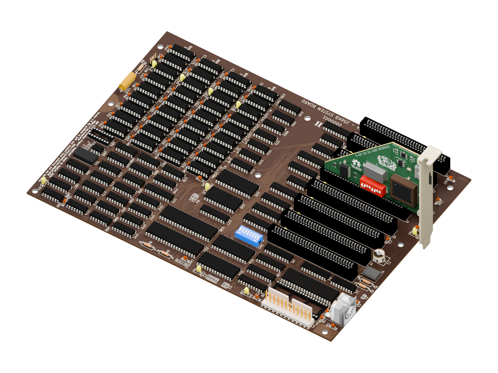
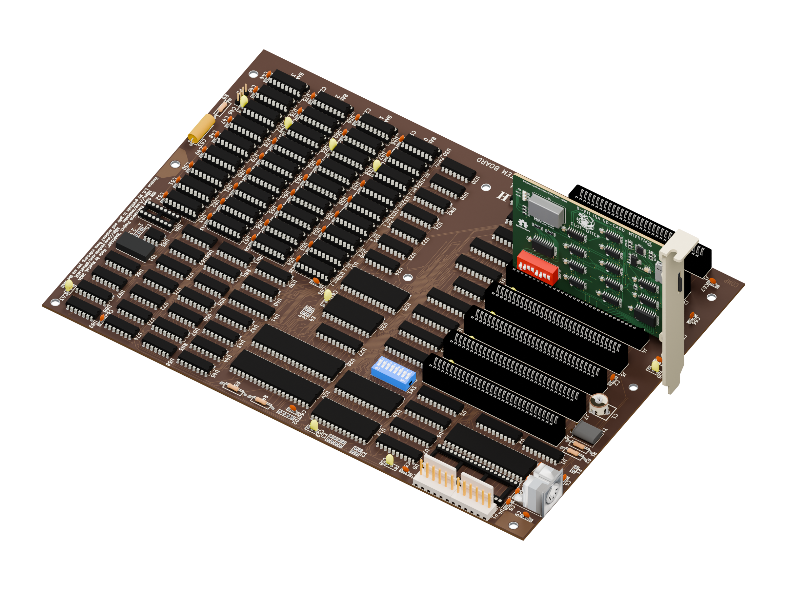

# Slot-otter installed in a mad5160 motherboard





`slot-otter-mad5160.blend` contains the complete mad5160 motherboard and the
existing Slot-otter Forge revision 1.0 assembly. `slot-otter-classic-mad5160.blend`
contains the original discrete-logic Classic assembly on the same motherboard.
Both cards occupy central ISA slot J4, the fourth of eight slots. Both scenes
are self-contained, with packed copper textures, materials, lights and matching
orthographic overview cameras. The PNGs are 2400 × 1800 with transparent
backgrounds, rendered in Cycles at 96 samples with denoising.

The generated motherboard scenes are kept locally in ignored
`archive/render-scenes/`, rather than stored in Git. Rebuild them using the
commands below. The rendered images and build scripts remain versioned.

The motherboard is **madcatse's IBM 5160 XT recreation**, not an IBM 5150.
Source: <https://github.com/madcatse/mad5160>, pinned at
`bcaec68e9f62e65e4869585f8ae647f260c2ae55`.
Its component placements, connector geometry, silkscreen and routing come from
the upstream KiCad PCB. Standard library models are resolved against KiCad 10;
matching STEP models replace old standard-library VRML references. Custom
models remain those supplied by mad5160. Dark amber-brown soldermask and pale
ink follow [Mister rf's photograph of an original IBM XT 5160 motherboard](https://commons.wikimedia.org/wiki/File:IBM_XT_5160_motherboard.jpg).
These are illustrative finishes; the source project's GLB preview colors are
white/black. Both boards and their plastic parts have matte surfaces, with
rougher metal surfaces to soften highlights. The Slot-otter PCB remains green.

The assemblies come from the existing [Forge scene](../cpld/render/README.md)
and [Classic scene](../release/render/README.md).
The 76.2 mm A1–A31 contact span is registered with J4; the component side faces
row A. Finger tips sit 6.5 mm above the motherboard coordinate plane, inside the
connector housing. This is an illustrative installed view, not a mechanical fit
qualification. The bracket extends below the motherboard at its rear edge;
there is no chassis or bracket retaining screw. Hardware source files are unchanged.

## Render the saved scene

Requires Blender 4.5 or later. From the repository root:

```sh
blender --background archive/render-scenes/slot-otter-mad5160.blend \
  --python-exit-code 1 \
  --python-expr "import bpy; bpy.ops.render.render(write_still=True)"
```

The stored output path points to `img/slot-otter-mad5160.png`.
For Classic, use `archive/render-scenes/slot-otter-classic-mad5160.blend`; its stored output
path points to `img/slot-otter-classic-mad5160.png`.

## Rebuild

Requires Git, Python 3 with NumPy and Pillow, KiCad 10 with its standard 3D
libraries, `rsvg-convert`, and Blender 4.5+. The checkout and temporary exports
below live in the repository's ignored `archive/` directory.

```sh
git clone https://github.com/madcatse/mad5160.git archive/mad5160
git -C archive/mad5160 checkout bcaec68e9f62e65e4869585f8ae647f260c2ae55
python3 pcb/context/prepare_mad5160.py \
  --source archive/mad5160 --models /usr/share/kicad/3dmodels \
  --output archive/mad5160-export
python3 pcb/cpld/render_copper.py --pcb archive/mad5160/Mad5160.kicad_pcb \
  --output archive/mad5160-export/copper
blender --background pcb/cpld/render/slot-otter-cpld-rev1.blend \
  --python-exit-code 1 --python pcb/context/render_installed.py -- \
  --card-model Forge --slot J4 \
  --motherboard archive/mad5160-export/compact.glb \
  --copper archive/mad5160-export/copper \
  --scene archive/render-scenes/slot-otter-mad5160.blend \
  --output img/slot-otter-mad5160.png --width 2400 --samples 96
blender --background pcb/release/render/slot-otter-discrete.blend \
  --python-exit-code 1 --python pcb/context/render_installed.py -- \
  --card-model Classic --slot J4 \
  --motherboard archive/mad5160-export/compact.glb \
  --copper archive/mad5160-export/copper \
  --scene archive/render-scenes/slot-otter-classic-mad5160.blend \
  --output img/slot-otter-classic-mad5160.png --width 2400 --samples 96
```

For Windows KiCad from WSL, pass
`--kicad-cli '/mnt/c/Program Files/KiCad/10.0/bin/kicad-cli.exe'` to both Python
export helpers and use
`--models '/mnt/c/Program Files/KiCad/10.0/share/kicad/3dmodels'`.
Place the checkout and export directory on a Windows-accessible drive.
The build used Blender 4.5.5 and Windows KiCad 10.0.

`prepare_mad5160.py` writes a temporary PCB with resolved model paths, exports
its populated GLB, then calls `compact_glb.py` to batch CAD faces by material.
Batching preserves indexed positions, normals and transforms while reducing
146,757 mesh primitives to 977, making Blender imports practical. No triangles
are removed. The render helper also transforms the saved card's copper shader
coordinates when standing it upright, keeping its routing registered to the PCB.
`--slot` accepts J1 through J8 and defaults to J4. Both saved source card scenes
share the same contact registration despite their slightly different top edges.

## Attribution and licenses

Motherboard design and supplied models: madcatse, copyright 2024, MIT; retain
[MAD5160-LICENSE.txt](MAD5160-LICENSE.txt) with the derived scene. KiCad library
models retain their [upstream terms and design exception](https://www.kicad.org/libraries/license/).
Slot-otter-derived geometry follows CERN-OHL-S-2.0; the rendering scripts use
GPL-3.0-or-later, and the documentation image uses CC-BY-SA-4.0. See the
[project licensing statement](../../LICENSE.md). Third-party terms remain in force.
