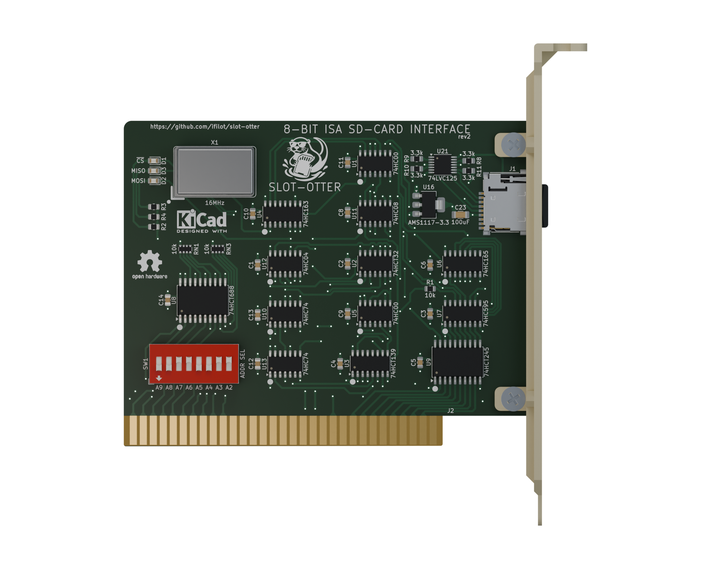

# Slot-otter Classic

Classic is the original discrete-logic Slot-otter board. It remains fully supported
and is functionally equivalent to [Slot-otter Forge](../cpld/README.md),
the CPLD-based board. Both boards use the same
OTTERSD driver, I/O port settings and SD card formats, with read and write
support. Follow the [main setup instructions](../../README.md#getting-started)
with either board.

This directory contains the Classic hardware sources. Use the matching
source revision when repairing or reproducing a card; these fabrication files
and pinouts differ from Forge's. See the
[Blender render instructions](render/README.md) to reproduce the image.

Project-authored hardware remains available under CERN-OHL-S-2.0 and this
documentation under CC-BY-SA-4.0; see [licensing scope](../../LICENSE.md).
